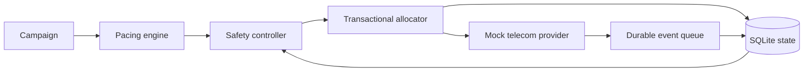
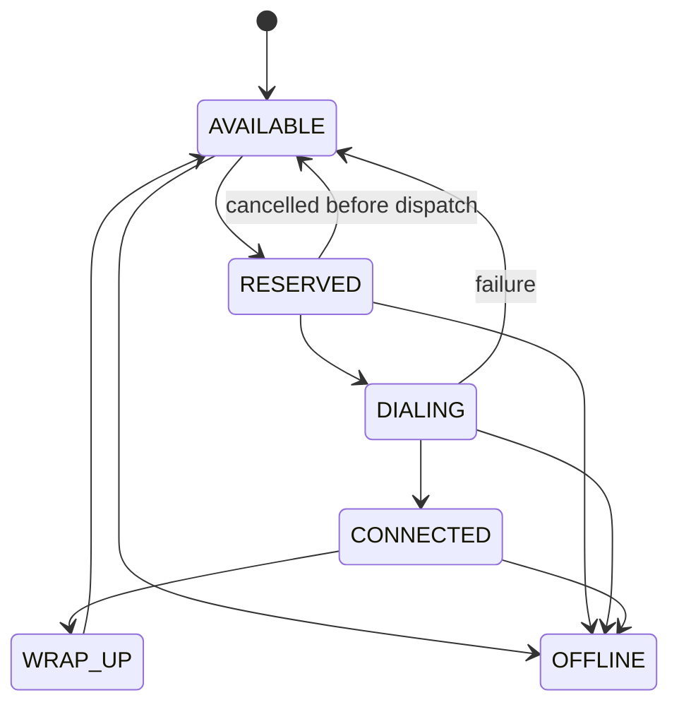
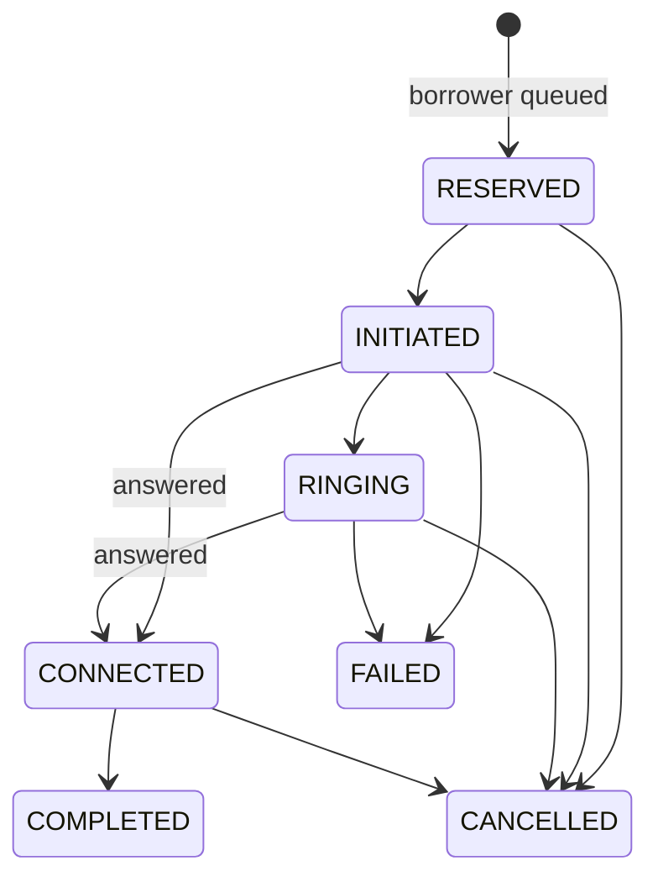

# SmartDialer | Safety-first functional prototype

## Run locally
Python 3.10+; no third-party packages or external services required.

```bash
python -m unittest -v
python simulation.py
python load_test.py
```
Each command creates temporary SQLite databases. Recorded outputs are included in the repository.

## Architecture

The pacing engine only returns a proposed count. The allocator calls the safety controller inside the same write transaction that reserves agents and borrowers. The mock provider is dispatched only for reserved calls.

## State machines


Terminal states are absorbing; duplicate answers are ignored. ANSWERED is normalized to CONNECTED. PAUSED and agent re-login are not implemented.

## Pacing
Progressive proposal = available agents. Predictive proposal = ceil(available agents / estimated answer rate), with rate bounded to [0.05, 1]. The simulation updates the estimate from observed connections / initiated calls (a deliberately simple, lagged estimator). Safety caps both modes to free agents and queued borrowers; outage or open circuit yields zero. Example: 10 agents and 20% answer rate gives a proposal of 50 but approval of 10. This is conservative predictive pacing, not speculative overbooking; equal utilization between modes is expected.

## Failure behavior
- Concurrent workers: SQLite BEGIN IMMEDIATE serializes reservation writes; partial unique indexes prevent two active calls for the same agent or borrower.
- Restart: initiated mock jobs and their events are committed together; reopening the database and processing due events resumes the call. Undispatched reservations are cancelled and borrowers requeued. Recovery assumes the old workers are stopped.
- Outage: no new calls; existing events continue. Three setup failures open a 30-second circuit. No automatic retry after uncertain dispatch; pre-dispatch cancellation may requeue a borrower.
- Agent departure: atomically marks offline and cancels the mock call; late events cannot resurrect it. Real telecom cancellation/handoff requires provider acknowledgement.
- Duplicate/out-of-order events: state guards prevent regression and double-counting. Completion before answer closes the call conservatively; late answer is ignored, so connection metrics may undercount.

## Simulation and performance
Four scenarios run for 300 simulated seconds with fixed random seed. Scenario D changes answer rate and talk duration, introduces an outage, and removes 40% of agents. Utilization = connected agent-seconds / online agent-seconds. Provider A is faster and more reliable; B is slower, noisier and less reliable. The load test measures reservation throughput with eight concurrent threads and separate database connections, not telecom throughput. See the recorded results.

## Limitations
This is a local prototype, not production telecom software. The mock provider's durable event queue is in the same database, unlike a real remote provider. No live telecom, distributed leases, multi-campaign fairness, full retry scheduler, paused state, or speculative predictive dialing. See ADR.md for production design and final question.
